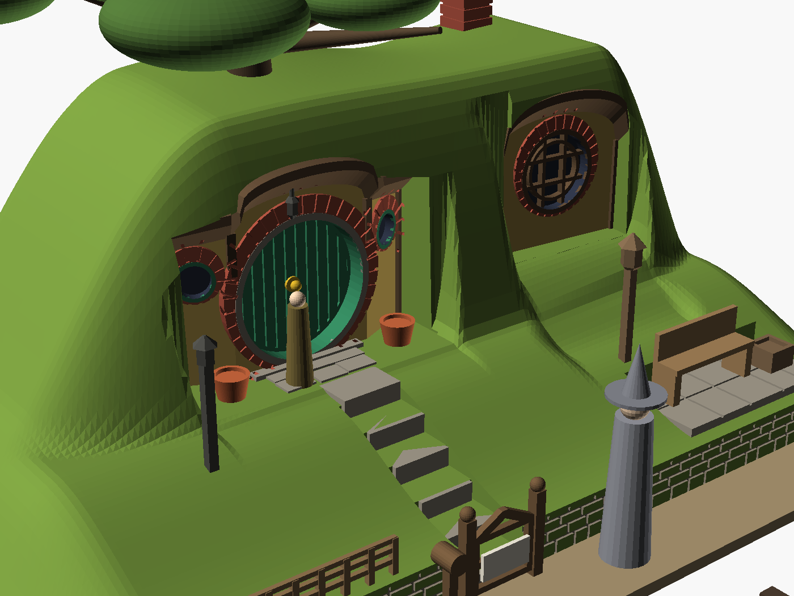

# Bag End

Bilbo's hobbit hole under The Hill, in HO scale (1:87), modelled on the Hobbiton Movie
Set in Matamata, New Zealand. Reference photos are in [refs/](refs/), with credits in
[refs/ATTRIBUTION.md](refs/ATTRIBUTION.md).

## How it was built from the photos

Everything on the facade is measured from the photos in units of the door diameter D,
then scaled with **D = 18 mm (about 1.57 m)**. No published size exists for the set's door,
and the Hobbiton holes were built at several scales, so D is a choice. The terracotta pots
in refs/01 put the real door at roughly 1.5 m. Change `D` and the whole facade follows.

| Feature | Measured | Source |
|---|---|---|
| Door bay width | 2.24 D | refs/01 |
| Eave top over the door | 1.39 D above the sill | refs/01 |
| Portholes | 0.23 D glass, 0.42 D with brick ring, 0.75 D up | refs/01, 02 |
| Window bay window | about 0.6 D glass, 0.8 D with brick ring | refs/03, 05 |
| Hill crest | 1.75 D above the sill | refs/03 |
| Oak crown | about 4.3 D across, trunk almost over the door | refs/03 |

Side-by-side checks: [compare_front.png](renders/compare_front.png) and
[compare_elevation.png](renders/compare_elevation.png).

## What's on it

- **Door bay:** three facets, with the side ones angled back into the hill.
  - Green planked door with a central knob, grey timber frame ring and a brick arch that's thicker at the crown, on a stone sill.
  - Brick-ringed portholes on each side.
  - Timber posts, and a curved eave with a 45° underside.
  - Lantern hung under the eave.
  - Flower pots on a flagstone landing.
- **Window bay:** set back and higher up the bank, with a round leaded window in a brick ring.
- **Garden:**
  - Six flagstone steps up from the lane.
  - The gate with the "No admittance" sign, a barrel letterbox and a woven fence.
  - A dry-stone retaining wall along the lane.
  - A birdhouse post and a lamp post.
  - A bench and planter on a flagstone patio.
- **Hill:** grass banks between the bays, a square brick chimney, and a 3.2 mm socket for the oak.

The oak, the figures and the track in the renders are preview props only, not part of the STL.

## Size

135 × 97 mm footprint, 60 mm tall to the chimney (about 11.7 × 8.4 m in the real world).
The sides and back taper almost to base level so it blends into a layout.

## Files

| File | What it is |
|---|---|
| `stl/bag_end.stl` | Solid model. Windows are shallow recesses to paint. |
| `stl/bag_end_lit.stl` | LED version. Rooms behind the portholes and the round window, open underneath. |
| `bag_end.scad` | Source. Proportions are named constants; the main ones are Customizer parameters. |

## Printing

Print upright on the base in PLA, with **supports off**. Every overhang is designed to print
without them: eaves at 45°, the lantern standing on the wall, gable-roofed LED rooms, and
short bridges on the gate, fence and bench. Your `0.10mm ... super custom` profile turns
supports on, so switch them off for this one.

| Setup | Time | Filament |
|---|---|---|
| 0.2 nozzle, 0.10 mm layers (best detail) | 13 h 46 m | 77 g |
| 0.4 nozzle, 0.12 mm layers | 6 h 20 m | 91 g |
| LED version, 0.2 nozzle | 14 h 56 m | 79 g |

Estimates come from `tools/estimate.sh` with the stock Centauri Carbon profiles (15% infill).
The brick joints and door planks are 0.4 mm grooves, sized for the 0.2 nozzle.

## Finishing

- **Paint:**
  - Door green with a brass knob.
  - Plaster ochre-yellow; posts, eaves and window frames dark brown; bricks red-brown.
  - Steps, sill and walls drybrushed grey.
- **Turf:** PVA plus static grass on the hill and banks. Clump foliage and flowers along the wall and bays. Ivy on the bank between the bays.
- **Oak:** a broad, flat HO oak, about 75–80 mm across, in the socket on top.
- **LED version:** glaze the windows with clear glue (such as Kristal Klear). Light from below with warm-white LEDs through a hole in the layout.

## Simplified or left out

- The arched tops of the plaster panels, the carved trim on the eaves and the leaded patterns in the portholes. These are too fine for FDM at HO, so paint them.
- The big ornate window bay further left along the hill, the pumpkin wheelbarrow, and the hedges.
- The hill is cut off at the module edges, where the real one carries on with more bays.
